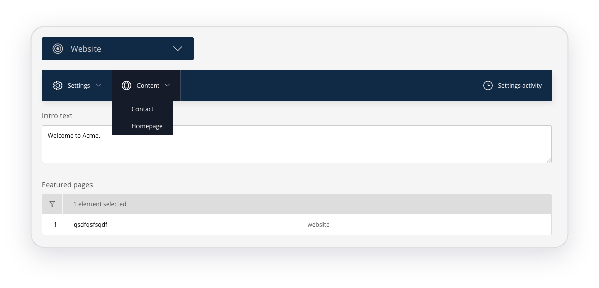

# Sulu Webspace Settings Bundle

Per-webspace settings for Sulu 3, composed the way you compose page templates. Declare a settings
area with a PHP attribute and a template XML, and editors get a form under **Webspaces** in the
admin, with every content type Sulu has.

## What's inside

- [**Settings areas**](https://sulu.eekes.be/sulu-webspace-settings-bundle/settings-areas): one attribute and one template XML per screen; no YAML, no entity.
- [**Templates and fields**](https://sulu.eekes.be/sulu-webspace-settings-bundle/templates-and-fields): every Sulu content type, translated per locale or shared across all of them.
- [**Twig**](https://sulu.eekes.be/sulu-webspace-settings-bundle/twig) and [**PHP**](https://sulu.eekes.be/sulu-webspace-settings-bundle/php): `settings('social')` in templates, a typed read model in services.
- [**Permissions**](https://sulu.eekes.be/sulu-webspace-settings-bundle/permissions): per webspace, and per area once you have more than one.
- [**Caching and references**](https://sulu.eekes.be/sulu-webspace-settings-bundle/caching-and-references): saving an area invalidates the HTTP cache of the pages that use it.

## Documentation

[Installation](https://sulu.eekes.be/sulu-webspace-settings-bundle/installation), [configuration](https://sulu.eekes.be/sulu-webspace-settings-bundle/configuration) and everything else: **[sulu.eekes.be/sulu-webspace-settings-bundle](https://sulu.eekes.be/sulu-webspace-settings-bundle)**.

## License

MIT
